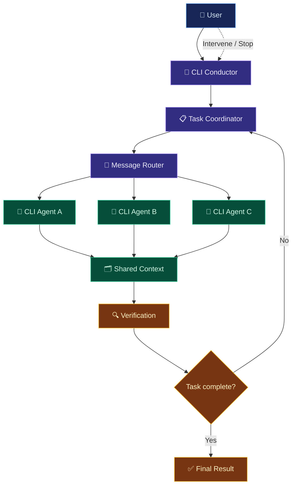

# 🎼 CLI Conductor

<p align="center">
  
</p>

<p align="center">
  <strong>One task. Multiple CLIs. A coordinated workflow.</strong>
  <br />
  Orchestrate AI coding agents, coordinate their work, and turn disconnected terminals into a unified development workflow.
</p>

<p align="center">
  
  
  
</p>

<p align="center">
  <a href="#-overview">Overview</a> •
  <a href="#-features">Features</a> •
  <a href="#-architecture">Architecture</a> •
  <a href="#-getting-started">Getting Started</a> •
  <a href="#-roadmap">Roadmap</a>
</p>

---

## ⚡ Overview

AI coding tools are powerful individually. Coordinating several of them across a single task is a different problem.

**CLI Conductor** is designed to bring multiple command-line AI agents into one coordinated workflow. Instead of manually switching between terminals, copying responses, and managing handoffs, the goal is to let agents exchange information, work on assigned responsibilities, and continue collaborating until the task is completed or the user intervenes.

### The idea

```text
       YOU
        │
        ▼
 ┌───────────────────┐
 │   CLI CONDUCTOR   │
 │ Task Coordination │
 │ Message Routing   │
 │ Execution Control │
 └─────────┬─────────┘
           │
     ┌─────┼─────┐
     ▼     ▼     ▼
  Agent A Agent B Agent C
     │     │     │
     └─────┼─────┘
           ▼
   Shared Task Context
           │
           ▼
    Verification & Result
```

*Architecture illustration of the intended multi-agent workflow.*

The objective is simple: **less manual coordination, more useful work completed.**

---

## ✨ Features

> Feature availability depends on the implementation and current project version. Planned capabilities should not be interpreted as already released.

### 🧠 Multi-agent coordination
- Bring multiple compatible CLI agents into a coordinated workflow.
- Assign different responsibilities to different agents.
- Share relevant task context between participating agents.
- Support agent-to-agent communication rather than relying exclusively on user-mediated copy and paste.

### 🔁 Persistent collaboration
- Design workflows that continue across multiple exchanges.
- Allow agents to review one another's outputs and request clarification.
- Track task progress and completion conditions.
- Let the user intervene, redirect work, or stop execution.

### 🛠️ Developer-focused workflow
- Keep CLI-based development at the center of the experience.
- Make agent activity and task state easier to understand.
- Support practical workflows such as implementation, code review, debugging, and testing.
- Aim for a clear path from task description to verified result.

### 🎛️ User control
- Keep the user in control of the overall task.
- Make execution status and agent activity visible.
- Design for explicit handling of errors, timeouts, and failed tasks.
- Prioritize predictable behavior over uncontrolled agent loops.

---

## 🏗️ Architecture

CLI Conductor can be organized around a small number of core responsibilities.



### Core components

| Component | Responsibility |
|---|---|
| Task coordinator | Manages the task lifecycle and decides what work remains. |
| Message router | Delivers messages to the appropriate agents. |
| CLI adapters | Integrate with supported command-line tools. |
| Shared context | Maintains relevant task information and outputs. |
| Execution controller | Handles cancellation, timeouts, and execution state. |
| Verification layer | Checks results against defined completion criteria. |

The diagram describes a proposed logical architecture, not a guarantee that every component is implemented.

---

## 🚀 Getting Started

### Prerequisites

Before running CLI Conductor, check the repository for its actual runtime requirements and supported CLI integrations.

You may need:

- A supported operating system.
- The runtime or compiler required by the current implementation.
- One or more compatible CLI agents.
- Any required authentication or API configuration for those agents.

### Installation

Clone the repository:

```bash
git clone <YOUR-REPOSITORY-URL>
cd <YOUR-REPOSITORY-DIRECTORY>
```

Follow the installation and launch instructions provided by the project for your current version.

> **Note:** Replace the repository URL and installation commands with verified project-specific values before publishing this README.

### Your first workflow

The intended workflow is:

1. Describe the task you want completed.
2. Select or configure the participating CLI agents.
3. Start the coordinated workflow.
4. Monitor progress and inspect agent outputs.
5. Intervene when necessary.
6. Review the final result and verify the changes.

---

## 💡 Example Use Cases

### 🧩 Feature development

One agent investigates the existing codebase, another implements the feature, and another reviews the changes.

### 🐛 Debugging

Agents investigate different possible causes, exchange findings, and help narrow down the root cause.

### 🧪 Testing and verification

An implementation agent produces a change while a separate agent evaluates tests, edge cases, and potential regressions.

### 🔍 Code review

Agents examine code from different perspectives, such as correctness, maintainability, security, and performance.

These are example workflows. Actual support depends on the integrations, permissions, and orchestration logic implemented in CLI Conductor.

---

## 🔐 Design Principles

CLI Conductor should be built around a few non-negotiable principles:

- **User authority:** The user can inspect, redirect, and stop a workflow.
- **Explicit permissions:** Agents should only receive the access required for their assigned tasks.
- **Observable execution:** Agent activity, errors, and task state should be inspectable.
- **Bounded execution:** Workflows should have configurable stopping conditions, timeouts, and resource limits.
- **Reliable completion:** An agent claiming success should not automatically count as proof that a task is complete.
- **Failure isolation:** One agent failing should not silently corrupt the state of the entire workflow.
- **Reproducibility:** Important actions and outputs should be traceable where practical.

### A critical distinction

More agents do not automatically mean better results.

Without clear task ownership, shared context, termination conditions, and independent verification, a multi-agent system can waste tokens, duplicate work, contradict itself, or loop indefinitely.

CLI Conductor's value depends on solving those coordination problems—not simply launching several terminals simultaneously.

---

## 🗺️ Roadmap

The following is a proposed roadmap, not a statement of current implementation status.

- [ ] Core orchestration engine
- [ ] CLI adapter system
- [ ] Agent-to-agent messaging
- [ ] Shared task context
- [ ] Task lifecycle and progress tracking
- [ ] User interruption and cancellation
- [ ] Configurable completion conditions
- [ ] Timeouts and failure recovery
- [ ] Execution history and debugging tools
- [ ] Independent verification of task results
- [ ] Automated integration and regression tests
- [ ] Documentation and example workflows

---

## 🤝 Contributing

Contributions should improve coordination reliability, compatibility, observability, usability, or test coverage.

A useful contribution process:

1. Open an issue describing the problem or proposed improvement.
2. Discuss significant architectural changes before implementation.
3. Keep changes focused and testable.
4. Add tests for new behavior and failure cases.
5. Update the documentation to match the actual implementation.

Please check the repository's contribution guidelines before submitting a pull request.

---

## 📄 License

The project's license has not been specified in this README.

Add the appropriate license and include the corresponding `LICENSE` file before distributing the project.

---

<p align="center">
  <strong>🎼 CLI Conductor</strong>
  <br />
  <sub>Coordinate the agents. Control the workflow. Verify the result.</sub>
</p>
